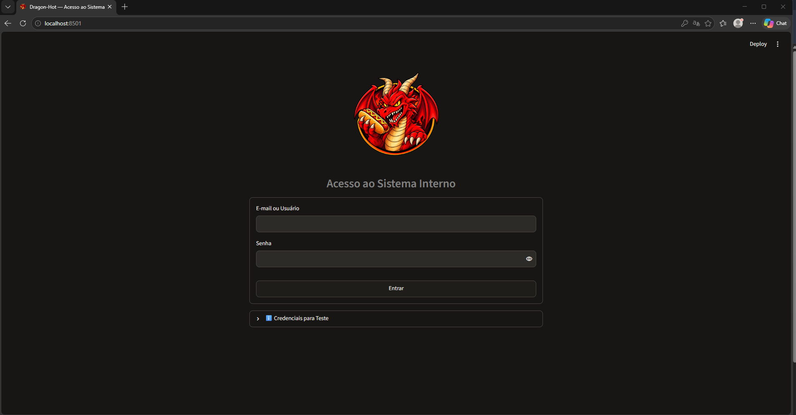
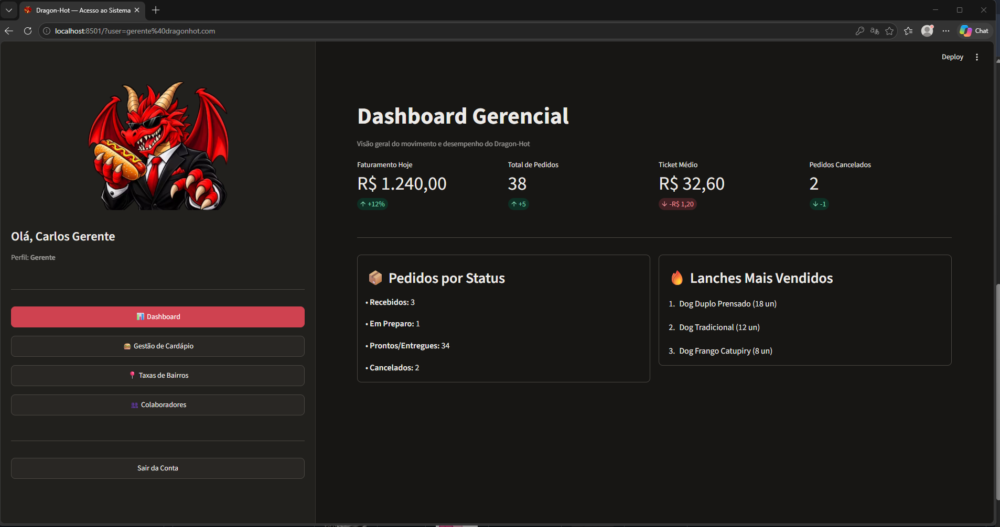
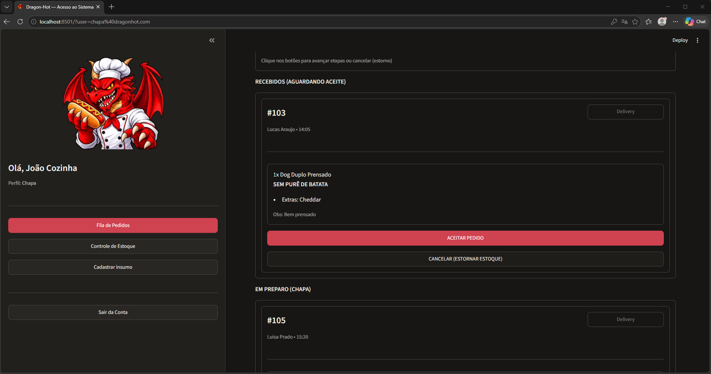

  

  

  <strong>Desenvolvido pelo Grupo Dragon Code</strong>

  
  
  
  

---

## 📋 Documentação do Projeto

### 🎯 Escopo e Planejamento
| Documento | Responsável | Link |
| :--- | :---: | :---: |
| **Definição de Nicho e Escopo** | Todos | [📄 Acessar](https://docs.google.com/document/d/1ZdYS0LZ1-4I7yzn2-JAly8MSa3qtClPNHVjZS0THHMI/edit?tab=t.0#heading=h.64gcyo8p9w3) |
| **Documento de Visão** | Gabriela | [📄 Acessar](https://docs.google.com/document/d/1AMXfXL_l_vDicBCOAGDvmNjXV349T1YXpS_BKX4R5y8/edit?tab=t.0) |
| **Cronograma** | Renato | [📄 Acessar](https://docs.google.com/document/d/1ujDivRhg49LPxq5hQFR7H3wofu4VHPn5gDU23Cd8vgA/edit?tab=t.0) |

### 📐 Design e Requisitos
| Documento | Responsável | Link |
| :--- | :---: | :---: |
| **Wireframe** | Lucas, Gabriela e Renato | [📄 Acessar](https://docs.google.com/document/d/1H_MTNMHQHBBLK6QKKs574K75FUKD3vdNpQEM8Fk1u20/edit?tab=t.30jailh1jvpa) |
| **Landing Page** | Lucas e Renato | [🎨 Figma](https://www.figma.com/design/XKJdLFi3GkEKJ77srnfgnk/Dragon-Hot?timeline=keyframe&node-id=0-1&p=f&t=Ds1GF8LLQVDpLswM-0) |
| **Requisitos Funcionais** | Gabriela e Renato | [📄 Acessar](https://docs.google.com/document/d/1jfzipSZ4cObNCC-chNFojDm3bddYiR9R1Cq9d_xu_BM/edit?tab=t.0) |
| **Requisitos Não Funcionais** | Gabriela e Renato | [📄 Acessar](https://docs.google.com/document/d/14P544X3pLRtalhM8U4i4vIZstDsDt-k7/edit) |
| **Requisitos e Regras de Negócio** | Gabriela | [📄 Acessar](https://docs.google.com/document/d/1HHGWG_VOe3tcnupIIlNchhPKaRdFLCrpQ4V8ZPqVcmU/edit?tab=t.0#heading=h.jiv21hifzhdq) |
| **Requisitos de Infraestrutura** | Renato | [📄 Acessar](https://docs.google.com/document/d/1cimw1cw9G9grL96yfbMWcyu3i-yX7kPy/edit) |
| **Relatório de Infraestrutura** |  | *Em breve* |

## 🚀 Funcionalidades do Sistema

* **👨‍💼 Painel do Gerente:**
  * Dashboard com métricas de faturamento, pedidos e ticket médio.
  * Gestão de cardápio, taxas de entrega por bairro e controle de colaboradores.
* **🔥 Painel da Chapa (Cozinha):**
  * Fila de pedidos em tempo real (*Recebidos*, *Em Preparo*, *Pronto/Entrega*).
  * Controle de estoque de insumos e estorno automático em caso de cancelamento.
 

## 📸 Telas do Sistema

| Tela de Login | Dashboard Gerencial | Fila da Cozinha |
| :---: | :---: | :---: |
|  |  |  |

### 👥 Equipe do Projeto

| Contribuidor | Perfil | Contribuidor | Perfil | Contribuidor | Perfil |
| :---: | :---: | :---: | :---: | :---: | :---: |
|  | [Lucasrnlc](https://github.com/Lucasrnlc) |  | [agabrielabatista](https://github.com/agabrielabatista) |  | [renatosilva17](https://github.com/renatosilva17) |
